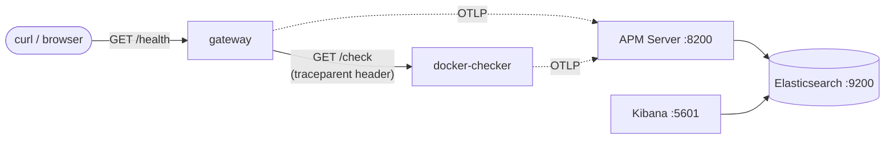

# Homelab Health & Service Monitor

A small distributed TypeScript system that checks the health of your homelab (containers, local APIs and network devices) and emits real **OpenTelemetry** traces to **Elastic APM**.

## Why

This is a hands-on observability project. It exists to:

- Learn distributed tracing end to end: instrumentation, context propagation, ingestion and analysis in Kibana.
- Produce realistic trace data that will feed a custom trace viewer (service map, trace waterfall) built with React.

## Architecture



- **gateway**: entry point. `GET /health` calls every checker and aggregates the results.
- **docker-checker**: reports the state of the Docker containers.
- Both services send traces and metrics over OTLP to APM Server, which stores them in Elasticsearch. Kibana's APM UI reads them from there.

## Features

- Automatic instrumentation of HTTP, Express and `fetch` through `@opentelemetry/auto-instrumentations-node`.
- W3C Trace Context propagation: a single request produces one trace that spans both services.
- Manual spans with custom `check.*` attributes and error status.
- OTLP export configured entirely through environment variables.
- Graceful shutdown that flushes pending spans before the process exits.

## Getting started

### Prerequisites

- Node.js 24+
- Docker with at least 4 GB of memory available

### Run it

1. Start Elasticsearch, Kibana and APM Server:

   ```bash
   docker compose up -d
   ```

2. Create your local environment file:

   ```bash
   cp .env.example .env
   ```

3. Install the dependencies:

   ```bash
   npm install
   ```

4. Start each service in its own terminal:

   ```bash
   npm run dev:docker-checker
   ```

   ```bash
   npm run dev:gateway
   ```

5. Generate some traffic:

   ```bash
   curl localhost:3000/health
   ```

### Production build

```bash
npm run build
npm run start:docker-checker
npm run start:gateway
```

## Configuration

| Variable                      | Description                                           | Default                 |
| ----------------------------- | ----------------------------------------------------- | ----------------------- |
| `OTEL_EXPORTER_OTLP_ENDPOINT` | Base URL of the OTLP receiver (APM Server)            | `http://localhost:4318` |
| `OTEL_EXPORTER_OTLP_PROTOCOL` | OTLP transport protocol                               | `http/protobuf`         |
| `DOCKER_CHECKER_URL`          | URL the gateway uses to reach docker-checker          | `http://localhost:3001` |
| `OTEL_SERVICE_NAME`           | Service name shown in Kibana (set by each npm script) | —                       |
| `PORT`                        | HTTP port of each service (set by each npm script)    | `3000` / `3001`         |

## Exploring the data

Open Kibana at <http://localhost:5601> and go to **Observability → Applications → Service inventory**:

- **gateway → Transactions → GET /health**: latency distribution and the trace waterfall, with the `docker-checker` transaction nested under the gateway's outgoing call.
- **gateway → Dependencies**: `docker-checker` detected as an instrumented downstream service.
- **Errors**: exceptions recorded on spans, grouped by type.

> The service map requires an Elastic Platinum license (or a trial).

## Project structure

```
src/
├── gateway/          # Entry point, aggregates the checkers
├── docker-checker/   # Container health check
└── shared/
    └── instrumentation.ts  # OpenTelemetry SDK setup, loaded with --require
```

## Roadmap

- [x] Query the real Docker socket in `docker-checker` (currently returns mock data)
- [ ] `http-checker`: probe local APIs (status code, latency)
- [ ] `network-checker`: reachability of devices on the LAN
- [ ] React dashboard instrumented with OpenTelemetry for the browser
- [ ] Run the services in Docker Compose alongside the Elastic stack
- [ ] Custom trace viewer (service map and waterfall) built on this data

## License

Licensed under the [Apache License 2.0](LICENSE).
